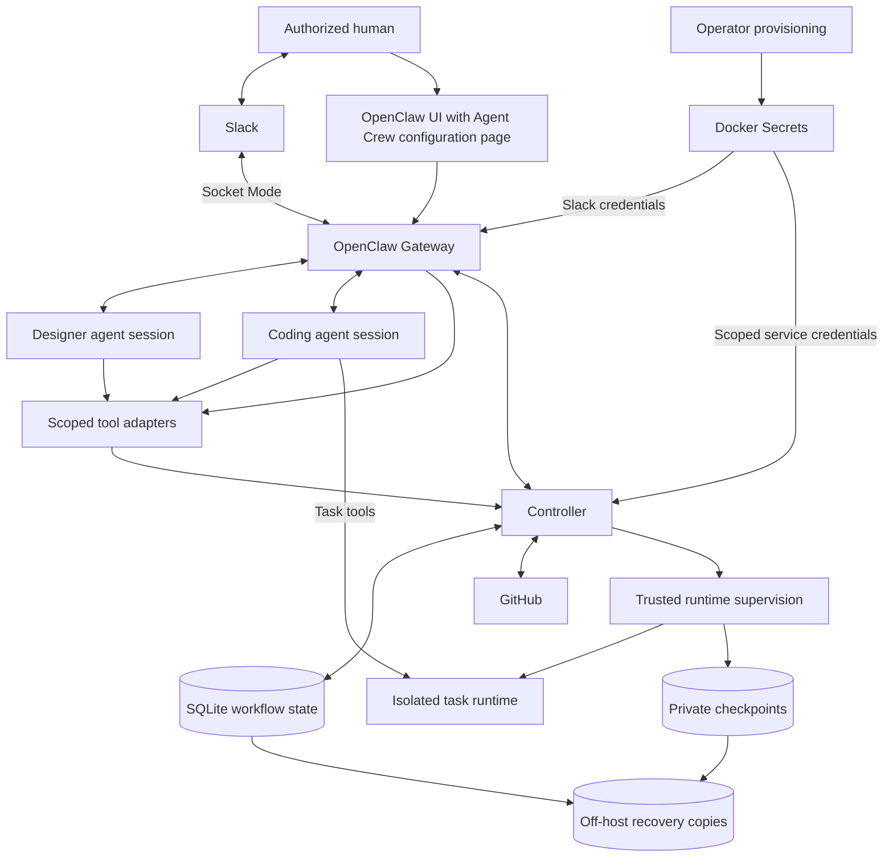

# Agent Crew architecture

Updated: 2026-11-02. Status: initial design draft.

[Specification](../spec.md) ·
[Open technical contracts](../spec.md#7-technical-decisions-and-verification)

## 1. Components and ownership

OpenClaw provides sessions, model calls, tool dispatch, Slack transport and
the management UI.

Slack and the UI build the job view from Controller records and current
Gateway, runtime, GitHub and delivery observations.

## 2. Controller modules

| Module | Operations | Responsibilities |
| --- | --- | --- |
| Repository configuration | Save, validate, activate and inspect revisions | Routing, secret references and configuration verification |
| Requirements | Read and update issues, record agreement and detect changes | Template versions, scope revisions, write receipts and edit conflicts |
| Job lifecycle | Admit, inspect, answer questions, pause, resume, cancel and retry | Job claims, ownership generations, permissions, capacity and budgets |
| Runtime supervision | Start, inspect, stop, preserve, restore and clean up | Swarm identity and placement, readiness, active-time enforcement and artifacts |
| Publication | Validate candidates, publish and inspect results | Source export, base revision, branch and PR bindings, checks and candidate approvals |
| Effect delivery | Record intent, execute, reconcile and report | Durable queue, operation identity, bounded retries and receipts |

Native tool and HTTP adapters pass caller identity, structured requests and
applicable session bindings to Controller modules. The modules authorize
against current permissions, repository and issue bindings, and the job,
execution and ownership generation for admitted coding work.

## 3. State and effect contracts

One active Controller writer owns SQLite on host-local persistent storage.
State is partitioned by repository. Keep source checkpoints and large logs
outside SQLite; task runtimes submit state changes through the Controller.
Use short transactions for job claims, versioned state updates and effect
intent. Perform network and runtime operations outside transactions.

| Record | Purpose |
| --- | --- |
| Configuration revision | Repository and channel identities, role assignments, policy and secret references |
| Scope revision | Issue evidence, human agreement, dependencies, and template and policy versions |
| Job | Stable job identity, phase, version, scope, blockers and cumulative usage |
| Execution | Job binding, ownership generation, source and image versions, session, runtime and budgets |
| Human decision | Verified human identity, authorization evidence, exact subject and version, and chosen outcome |
| Effect | Operation identity, argument fingerprint, authorized intent, ownership, outcome and remote receipt |
| Checkpoint | Source artifact identity, integrity checks and restoration metadata |
| Validation evidence | Candidate commit, validation commands and results |

The effect-delivery module persists intent and an argument fingerprint before
calling an adapter. Operation identities deduplicate requests; execution and
ownership generations fence stale workers. The lifecycle and reconciliation
rules are defined in [R8](../spec.md#r8-durable-state-and-external-effects).

## 4. Source and runtime boundaries

Task tools, subprocesses and package scripts share the execution's workspace
and network permissions. Runtime supervision places and inspects the
task runtime, verifies termination, and captures or restores source checkpoints.
Recovery and cleanup conditions are defined in
[R10](../spec.md#r10-preservation-operations-and-recovery).

The Controller's publication module exports the exact candidate commit and
checks its scope, base revision, validation evidence and bound GitHub targets.
The publisher holds scoped, short-lived credentials and does not execute
candidate code. Publication rules are defined in
[R7](../spec.md#r7-publication-review-and-completion).

The requirements module compares polled issue content with scope revisions
and write receipts, sending unexpected changes to the coding agent. The issue
adapter applies the conditional-update and conflict rules in
[R5](../spec.md#r5-collaborative-changes-and-unexpected-issue-edits).

## 5. Permissions and trust boundary

Docker Swarm hosts v1 on one trusted machine. Infrastructure privileges stay
with the Gateway, Controller and runtime supervisor. Task runtimes and CI jobs
receive no publication credentials or Docker/Swarm administration access.

Secret mounts, host-operation grants and credential rotation are covered by
[T05](../spec.md#7-technical-decisions-and-verification).
